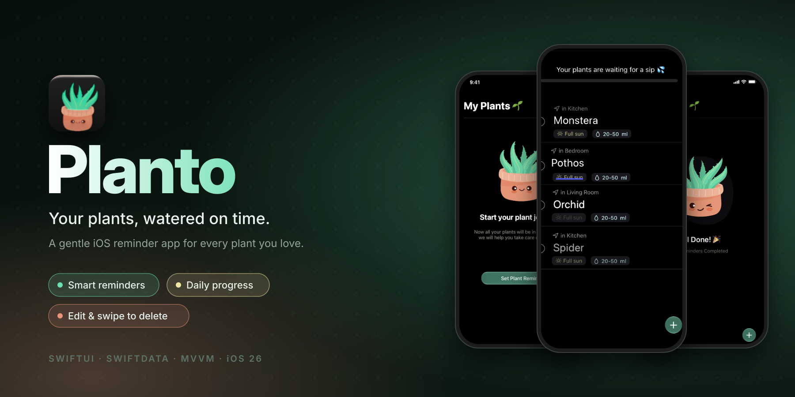
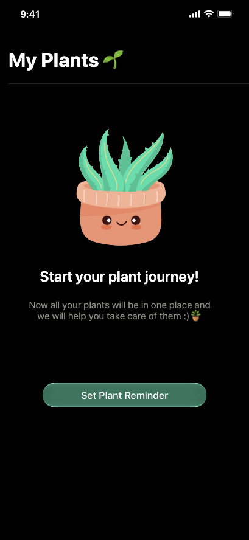
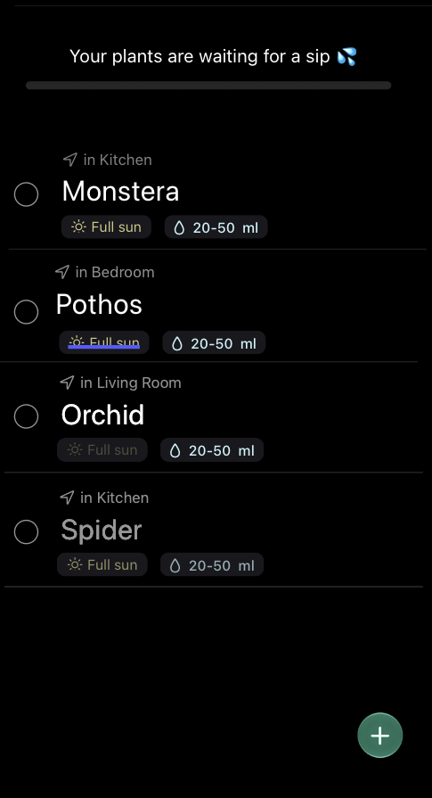
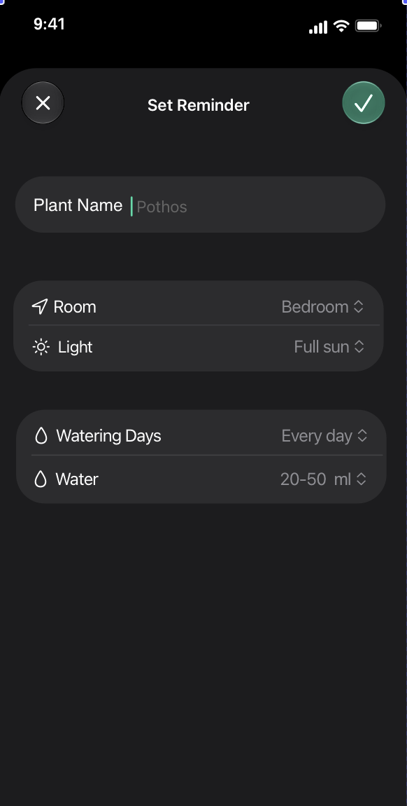
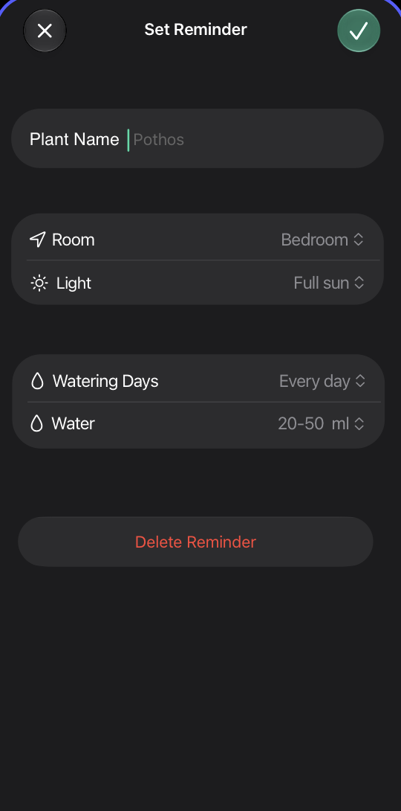
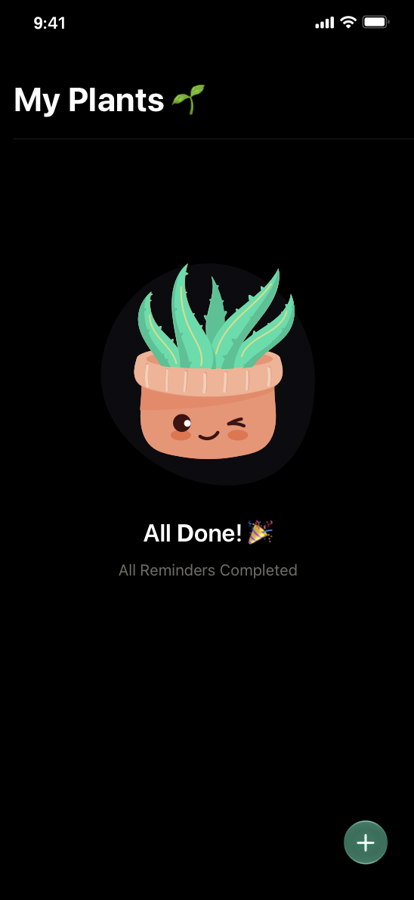
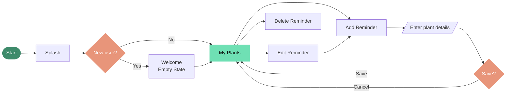

<p align="center">
  
</p>

<p align="center">
  
  
  
  
  
</p>

<h3 align="center">Your plants, watered on time 🌱</h3>

---

## 🪴 About

**Planto** is a simple iOS app that helps you take care of your plants.
Add each plant with its room, light, and watering schedule, and Planto will remind you when it's time to water it 💧

---

## ✨ Features

| | Feature | Description |
|:-:|---|---|
| 🌱 | **Welcome screen** | Shown only the first time you open the app |
| ➕ | **Add a plant** | Name, room, light, watering days, and water amount |
| ✏️ | **Edit a plant** | Tap any plant to update its details |
| 🗑️ | **Delete a plant** | Swipe to delete, or use the delete button inside the edit page |
| ✅ | **Mark as watered** | Tap the circle next to a plant |
| 📊 | **Daily progress** | A progress bar that fills up as you water your plants |
| 🎉 | **All done** | A happy screen when every plant has been watered |
| 🔔 | **Reminders** | Local notifications that repeat based on each plant's watering days |
| 💾 | **Saved on device** | Plants are stored locally with SwiftData |

---

## 📱 Screenshots

<table align="center">
  <tr>
    <td align="center"><br><sub><b>Welcome</b></sub></td>
    <td align="center"><br><sub><b>My Plants</b></sub></td>
    <td align="center"><br><sub><b>Set Reminder</b></sub></td>
    <td align="center"><br><sub><b>Edit Reminder</b></sub></td>
    <td align="center"><br><sub><b>All Done</b></sub></td>
  </tr>
</table>

---

## 🔄 User Flow



---

## 🛠️ Tech Stack

| Tool | Used for |
|---|---|
| **SwiftUI** | Building all the screens |
| **SwiftData** | Saving plants on the device |
| **UserNotifications** | Scheduling watering reminders |
| **AppStorage** | Remembering if the user opened the app before |
| **MVVM** | Organizing the code |

---

## 🗂️ Project Structure

```
plantApp
├── 📁 Model
│   └── plantsClass.swift          # Plant model + Room, Light, WateringDay, Water enums
├── 📁 Services
│   └── NotificationService.swift  # Ask permission, schedule & cancel reminders
├── 📁 ViewModel
│   └── PlantViewModel.swift       # Add, update, delete plants
├── 📁 Views
│   ├── StartYourPlantJourney.swift
│   ├── NoReminders.swift          # Dashboard (My Plants)
│   └── SetReminder.swift          # Add & edit sheet
├── MyApp.swift
└── Assets
```

```
View  ──►  ViewModel  ──►  NotificationService  ──►  iOS 🔔
               │
               └──►  SwiftData 💾
```

---

## 🚀 Getting Started

1. Clone the repo
   ```bash
   git clone https://github.com/<your-username>/<repo-name>.git
   ```
2. Open `plantApp.xcodeproj` in **Xcode 26**
3. Choose an iPhone simulator and press **Run** ▶️
4. Allow notifications when asked 🔔

---

<p align="center">
  Made with 💚 by <b>Hajer</b>
</p>
